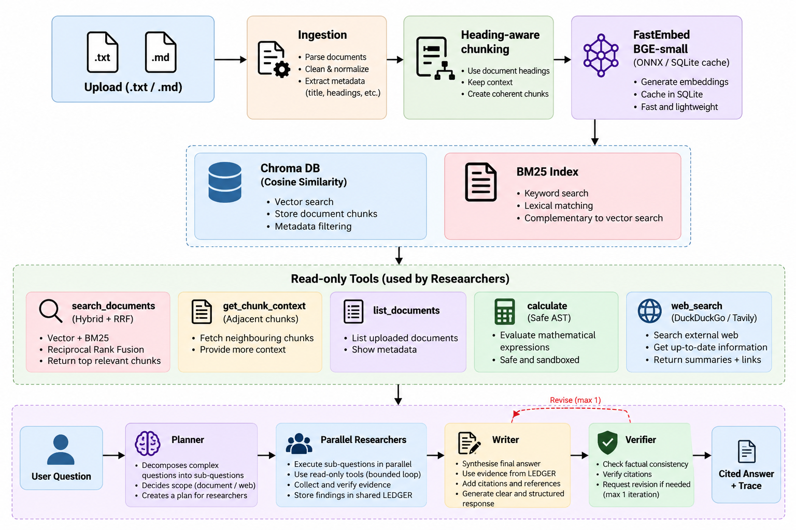

# Agentic Document Research Assistant

A complete, production-grade retrieval-augmented generation (RAG) and multi-agent document research system.

The system ingests markdown and plain text files, indexes them using hybrid retrieval (dense ONNX vector embeddings with FastEmbed fused with sparse BM25 keyword matching), and coordinates an orchestrated team of specialized LLM agents to plan, research, write, and verify grounded answers with verifiable citations at sub-second generation speeds.

---

## Architecture Overview

```

```

### Core Components

1. **Heading-Aware Ingestion (`src/ingest.py`)**:
   - Parses Markdown hierarchy (`#` to `###`) to preserve section context (e.g., `Risk Factors > Competition`).
   - Splits on paragraph boundaries with character budgeting (700-900 chars, 100-150 char overlap).
   - Prepend heading context to embeddings while storing display text separately.
   - Computes SHA1 file hashes for idempotent upserts.

2. **Hybrid Retrieval with Reciprocal Rank Fusion (`src/store.py`, `src/retrieval.py`)**:
   - Computes dense vector embeddings locally using **FastEmbed** (`BAAI/bge-small-en-v1.5`, 384 dimensions, L2-normalized) cached in SQLite (`.cache/embeddings.db`). Zero network latency, zero quota.
   - Chroma vector store (cosine distance) retrieves top candidates.
   - `BM25Okapi` index matches exact terminology, product codes, and acronyms.
   - Reciprocal Rank Fusion (RRF, k=60) merges rankings to maximize retrieval recall.

3. **Multi-Agent Orchestration with LangGraph (`src/agents/`)**:
   - **Planner (`planner_node`)**: Categorizes complexity and decomposes queries into independent `SubQuestion` items using `openai/gpt-oss-20b` on Groq.
   - **Parallel Researchers (`researcher_node`)**: Hand-written, bounded tool loop (max 6 calls). Appends retrieved passages to an immutable `Evidence` ledger.
   - **Writer (`writer_node`)**: Synthesizes findings using exclusively the retrieved evidence IDs with `openai/gpt-oss-120b`. Appends inline `[chunk_id]` citations to every factual sentence.
   - **Verifier (`verifier_node`)**: Deterministically catches hallucinated or un-retrieved citations; runs `openai/gpt-oss-120b` to verify that cited text entails every draft claim.
   - **Finalize (`finalize_node`)**: Honest abstention if no facts were discovered; appends unverified disclaimers if claims fail verification.

---

## Manual Setup and Run Instructions

### 1. Prerequisites

- Python 3.10 or 3.11
- A free Groq Cloud API Key from [console.groq.com](https://console.groq.com)

### 2. Environment Setup

```bash
# Clone the repository
cd /path/to/doc-research-agent

# Create and activate a clean virtual environment
python3 -m venv .venv
source .venv/bin/activate      # On Windows: .venv\Scripts\activate

# Install required dependencies
pip install -r requirements.txt
```

### 3. API Key Configuration

Create a `.env` file in the project root:

Edit `.env` and set your Groq key:
```env
GROQ_API_KEY=gsk_YourGroqApiKeyHere
MODEL_FAST=openai/gpt-oss-20b
MODEL_STRONG=openai/gpt-oss-120b
MODEL_JUDGE=openai/gpt-oss-120b
EMBEDDING_MODEL=BAAI/bge-small-en-v1.5
EMBEDDING_DIM=384
WEB_SEARCH_PROVIDER=ddgs
WEB_ENABLED=0
LLM_MAX_CONCURRENCY=3
```

### 4. Smoke Test

Verify your Groq API key, model connectivity, and FastEmbed local embeddings:

```bash
python -m scripts.check_groq
```
All five checks (Groq connectivity, chat, FastEmbed local embeddings, structured output, tool calls) must report `PASS`.

### 5. Running Offline Tests

Run the complete offline test suite (no API key required):

```bash
python -m pytest
```

### 6. Ingesting Documents

Ingest the sample corpus into a persistent Chroma collection (`.chroma/`):

```bash
# Optional: if you had previous embeddings with different dimensions, remove the old store
rm -rf .chroma .cache

python -m src.ingest evals/corpus --persist .chroma
```

---

### 7. Streamlit Web Interface

Launch the interactive UI:

```bash
streamlit run app.py
```

Features in the UI:
- Sidebar Groq API key override and configuration switches.
- Drag-and-drop document uploader with chunking status.
- Expandable live execution trace (`st.status`).
- Verified source cards showing exact cited passages and provenance.

---

## Future Work

The following features were intentionally excluded from the initial scope and represent future directions:
- Guardrails and safety harness (prompt-injection test cases, output filters, PII redaction)
- Re-ranking pipeline (cross-encoder or LLM reranker) evaluated in the benchmark tables
- MCP (Model Context Protocol) tool exposure
- Deep web page fetching with content sanitisation
- PDF and DOCX document ingestion parsers
- Production tracing with Langfuse or OpenTelemetry
- CI/CD automated eval regression gates on pull requests
- Conversation history and multi-turn session memory
- Multi-annotator golden evaluation sets with statistical confidence intervals
